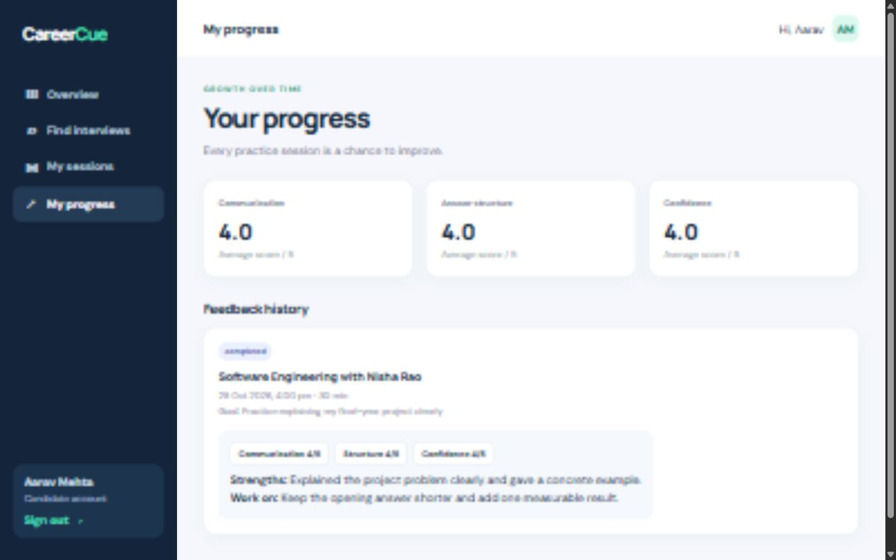

# CareerCue

CareerCue is a peer mock interview and feedback platform built for an individual Software Engineering course project.



## Run

Requires Node.js 20 or newer. No package installation is needed.

```sh
npm start
```

Open http://localhost:3000.

| Role | Email | Password |
| --- | --- | --- |
| Candidate | candidate@careercue.demo | Demo123! |
| Interviewer | interviewer@careercue.demo | Demo123! |

Demo data is created automatically in `data/careercue.json` on the first request. To reset the demo, stop the server and delete that file.

## Demo walkthrough

1. Sign in as the candidate and book an available Software Engineering slot.
2. Sign out and sign in as the interviewer.
3. Open My sessions, review suggested questions, save interviewer notes, mark the interview complete, and enter scores and written feedback.
4. Sign back in as the candidate to see the feedback and progress dashboard.

## Features

- Role-based candidate and interviewer views
- Open interview slots, booking, and duplicate-booking prevention
- Interview completion and structured feedback
- Interview preparation prompts and saved interviewer notes
- Candidate progress averages and session history
- Persistent local JSON storage and hashed demo passwords

## Architecture

The frontend uses HTML, CSS, and browser JavaScript. The server uses only Node.js built-in modules, serving a small JSON API and storing data locally. The app is designed for a local course demo and does not require an internet connection for core features. The optional Google Font falls back to system fonts offline.

## Test

```sh
npm test
```

The smoke test uses a temporary database and checks login, booking, conflict handling, role permissions, completion, and feedback.

To customize the interface or data, see [Editing CareerCue](EDITING_GUIDE.md).

## Course project

Software Engineering (IT_3131), V Semester, CSE Data Science. The project report is distributed separately from this source repository.

